# Presença e Produtividade dos PCs

> **Projeto de portfólio.** Sistema completo de presença e produtividade de PCs (agent em PowerShell, servidor PHP + SQLite, painel web). Todos os nomes, domínios, redes (`10.x`, faixas de documentação), endereços MAC, usuários e unidades (`MTZ`, `FL1`, `FL2`) são **exemplos fictícios**. Para usar de verdade, edite `Config/unidades.json` com a sua rede e gere as suas próprias chaves (`Agent\Assinar-Atualizacao.ps1 -NovaChave`).

## Sumário

1. [Objetivo](#1-objetivo)
2. [Stack](#2-stack)
3. [Arquitetura](#3-arquitetura)
    - 3.1. [Diagrama de fluxo](#31-diagrama-de-fluxo)
    - 3.2. [Estrutura de diretório](#32-estrutura-de-diretório)
    - 3.3. [Segurança do painel](#33-segurança-do-painel)
4. [Variáveis de ambiente](#4-variáveis-de-ambiente)
5. [Infraestrutura e deploy](#5-infraestrutura-e-deploy)
6. [Guia do desenvolvedor](#6-guia-do-desenvolvedor)
    - 6.1. [Setup e modos de execução (localmente/produção)](#61-setup-e-modos-de-execução-localmenteprodução)

## 1. Objetivo

Detecta **onde** cada PC de trabalho está (escritório MTZ/FL1/FL2, remoto, VPN) e **o que é acessado** nele (sites), e gera relatórios para a gestão: localização, produtividade e um painel BI.

```
PC (agent PowerShell) --HTTPS--> servidor PHP + SQLite (hospedagem compartilhada) --> painel web (login)
```

> O que se mede é a localização do **PC** e os sites abertos **no PC**, não a pessoa. Veja "Uso responsável (LGPD)" abaixo.

### 1.1. O que o painel tem

| Aba | Conteúdo |
|---|---|
| **Presença agora** | Cartões por situação, tabela de máquinas, histórico de 48 h, gráfico de 14 dias |
| **Painel BI** | Exporta localização e produtividade (CSV) e imprime. Por colaborador: % produtivo, tempo por categoria, dias presenciais x remotos x sem registro, unidade; evolução diária; sites mais acessados; clique no nome para o detalhe (dias, sites, últimos acessos) |
| **Produtividade** | Tabela produtivo x improdutivo x neutro por colaborador no período, exportável em CSV (Excel) ou impressão/PDF |
| **Classificação de sites** | Regras domínio → produtivo / improdutivo / neutro; lista dos sites ainda sem regra, para classificar com um clique |
| **Administração** (admin) | Nome completo e setor de cada colaborador; usuários do painel; exportação dos acessos detalhados; **políticas de instalação de software** nos PCs (pacotes assinados, zip, gatilho, desinstalação e aplicação automática) |

**Filtros de período** (BI, Produtividade e Administração): botões 7 dias, 30 dias, 90 dias, Este mês e Mês passado, com o ativo destacado e o intervalo escrito ao lado ("26/10/2026 a 24/11/2026 · 30 dias"). "Personalizado" mostra as duas datas, e o intervalo nunca fica invertido. No BI, a busca por colaborador abre uma **lista de sugestões ao digitar** (nome em destaque, login, setor e % produtivo, com setas, Enter e Esc) e **todos os números da tela acompanham o filtro**: cartões, gráficos por dia, sites e programas mais usados e listas, calculados no servidor só para quem a busca cobre (`/api/bi?logins=a,b`). Há "Limpar busca" (ou Esc), e todas as saídas ficam no menu **Exportar** (Excel, CSV de localização, CSV de produtividade, Imprimir/PDF).

Colaboradores aparecem como **"Maria Souza - msouza"**. O nome vem do Active Directory (`displayName`) ou da conta local; se não existir, aparece só o login e o administrador pode preencher o nome na aba Administração (esse nome manual nunca é sobrescrito).

### 1.2. Regras de negócio

**Produtividade.** Cada acesso (domínio) tem uma categoria. A regra vale para o domínio e seus subdomínios; a mais específica vence (`drive.google.com` = produtivo, `google.com` = neutro). Site sem regra = neutro, e entra na lista "sem classificação". A classificação é aplicada **na hora do relatório**: mudar uma regra reclassifica todo o histórico.
`% produtivo = produtivo ÷ (produtivo + improdutivo)` por **tempo**; o neutro não entra na conta.

**Tempo de cada acesso.** O agent estima o tempo como o intervalo até o próximo acesso (qualquer navegador), limitado a 5 min (`limite_visita_seg`). O tempo "de tela" que o Chrome grava foi descartado de propósito: ele conta abas esquecidas abertas em segundo plano. É uma estimativa de atenção, não um cronômetro.

**Localização por dia.** Um dia útil (seg–sex, menos `feriados`) é **presencial** quando há pelo menos `presenca_min_leituras` leituras presenciais (padrão 3 ≈ 15 min) e elas são ≥ `presenca_pct_min`% (padrão 50) das leituras com rede do dia. "Presencial via VPN" conta como presencial. Dia com leituras sem esse critério = **remoto**. Dia sem nenhuma leitura = **sem registro** (PC desligado, férias, atestado). O resumo por dia fica guardado por 400 dias, mesmo depois que as leituras minuto a minuto (90 dias) são apagadas. A exportação `presenca.csv` traz uma linha por colaborador/dia, para qualquer uso externo.

### 1.3. Privacidade dos sites acessados

- O agent lê o **histórico** do Chrome, Edge, Brave e Firefox do usuário logado. Não captura conteúdo de páginas, digitação, senhas, nem navegação anônima (o navegador não a grava no histórico).
- A **consulta (`?...`) e o fragmento (`#...`) das URLs são removidos no PC**, antes do envio (podem ter tokens e dados pessoais). O servidor remove de novo, por segurança.
- URLs detalhadas ficam **30 dias** (`retencao_nav_dias`); o resumo por domínio/dia, 400 dias.
- Dá para desligar a coleta de sites num PC (`Install-Agente.ps1 -SemNavegacao`, ou `"coletar_navegacao": false` no `agente.json`) e ignorar sites internos (`"ignorar_sites": ["intranet.empresa.com"]`).

### 1.4. Uso responsável (LGPD)

Monitorar navegação e localização de colaboradores é tratamento de dados pessoais. Antes de ligar a coleta de sites nos PCs: informe os colaboradores (política de uso/monitoramento assinada ou comunicado formal), defina a finalidade (gestão de produtividade e localização) e restrinja o acesso ao painel a quem precisa. Recomenda-se validar o texto com o jurídico/DPO. Como a presença é inferida pela localização do **PC**, confira os casos duvidosos (notebook esquecido no escritório, PC usado por outra pessoa etc.) antes de tomar decisões a partir do relatório.

### 1.5. Visão geral dos módulos

O projeto vai além de "ver quem está onde": é uma pequena plataforma de gestão de parque de PCs, toda feita sem frameworks.

| Módulo | O que faz |
|---|---|
| **Presença** | Descobre se o PC está no escritório (por rede física, gateway e MAC), em casa, ou via VPN, e registra a mudança de local na hora (eventos de rede do Windows) |
| **Produtividade** | Sites acessados e programas em foco, classificados como produtivo, neutro ou improdutivo (catálogo embutido e regras do administrador), score, relatórios mensal, semanal e individual, painel BI e comparativo home × presencial |
| **Inventário** | Hardware e sistema de cada máquina enviados pelo agent, com histórico de mudanças e importação/exportação de planilha |
| **Acesso remoto** | **RustDesk com relay interno** (servidor próprio, portas 21115–21117): o agent instala o cliente com hash conferido, aponta para o relay da empresa e só age nas máquinas que o administrador libera no painel |
| **Instalação e desinstalação de software** | Políticas de instalação nos PCs: instaladores `.msi`/`.exe`, scripts ou pacotes `.zip`, com arquivo gatilho, desinstalação e **aplicação automática** em PCs novos. Todo pacote é **assinado no navegador** do administrador e o agent só executa o que confere |
| **Atualização do agent** | O agent se atualiza sozinho a cada 6 horas com um pacote assinado (RSA) e troca o token de cadastro por um **token próprio por máquina** |
| **Monitoramento** | Batimento dos servidores a cada 5 minutos (mostra "no ar" ou "fora do ar"), endpoint `/health`, alertas por e-mail (queda de envio e falhas de login) e auditoria de tudo que o administrador faz |
| **Backup e publicação** | Instantâneo diário do banco, cópia com verificação de integridade e rotação, publicação por FTPS com cópia da versão anterior e atalho para desfazer |
| **Segurança** | Login com sessão e CSRF, verificação em 2 etapas (TOTP), reconfirmação de senha em ações sensíveis, API de dados somente leitura com token e opção de ocultar nomes (LGPD) |

## 2. Stack

| Camada | Tecnologia |
|---|---|
| Servidor | PHP 7.4 ou mais novo (testado também no 8.3) com PDO SQLite, em hospedagem compartilhada (hospedagem compartilhada, Apache). Um único `index.php` roteia tudo (`.htaccess`). |
| Banco | SQLite (arquivo `presenca.sqlite`), modo WAL, migração automática por versão (`VERSAO_BANCO`). |
| Painel | HTML, CSS e JavaScript puros, sem build e sem framework. Visual próprio (tokens de cor e tipografia em `style.css`), com tema claro e escuro. |
| Agent (PCs) | PowerShell 5.1 (Windows 10/11), tarefas agendadas do Windows, atualização automática com pacote **assinado** (RSA). |
| Acesso remoto | RustDesk 1.5.3 nos PCs e relay próprio (`hbbs`/`hbbr` 1.1.16) numa VM Debian na rede interna. |
| Publicação | Script PowerShell por FTPS (`curl.exe` do Windows), com backup e reversão. |
| Testes | Node 18+ (`node:test`) para o servidor, Pester 3.4 para o agent, simulador de carga em Node. |
| Documentação | Markdown com diagramas Mermaid (`sequenceDiagram`). |

## 3. Arquitetura

### 3.1. Diagrama de fluxo

Visão geral: os PCs falam com o servidor por HTTPS, o administrador usa o painel (login com sessão e 2FA) e a publicação e o backup passam por FTPS a partir de um PC de administração.

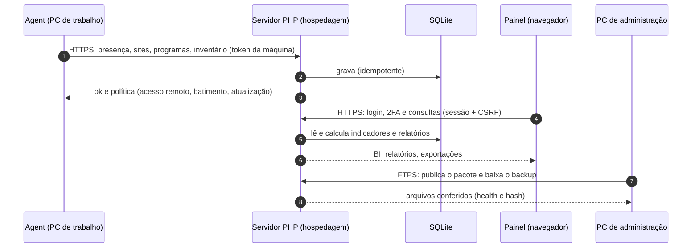

> **Convenção deste README:** todo fluxo novo ou alterado é documentado com um **diagrama de sequência** Mermaid (` ```mermaid ` + `sequenceDiagram`), com `autonumber`, participantes com apelido (`participant AG as Agent`),
> `loop` / `opt` / `alt` para repetições e condições e `Note over` para regras de negócio. Mantenha o diagrama junto da seção do recurso e atualize-o na mesma alteração de código.
> Cuidado com a sintaxe: **não use `;` dentro dos textos** das mensagens (o Mermaid o trata como fim de comando e o diagrama quebra) e evite `#` (usado em códigos de caractere). Valide antes de commitar, por exemplo colando o bloco em https://mermaid.live.

#### Ciclo do agent no PC (a cada 5 min)

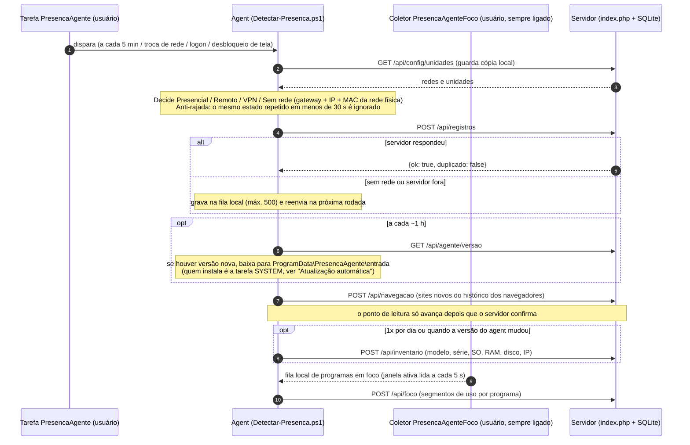

#### Login do painel

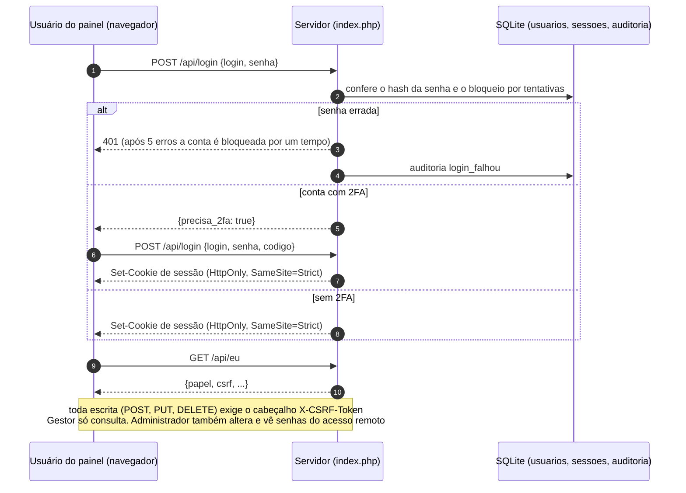

#### Atualização automática do agent

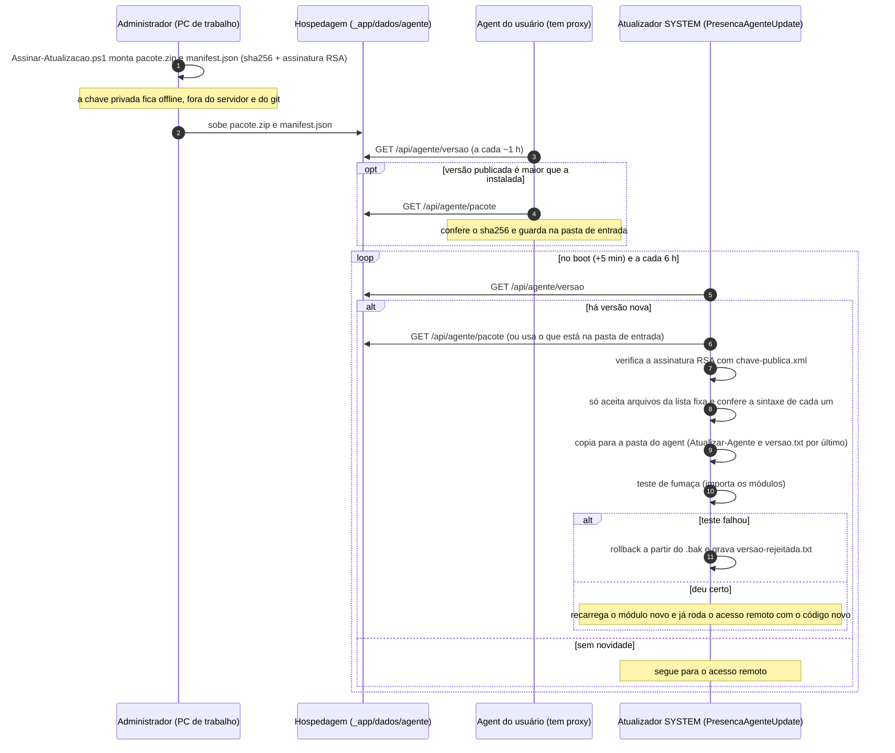

#### Instalação e configuração do acesso remoto (RustDesk)

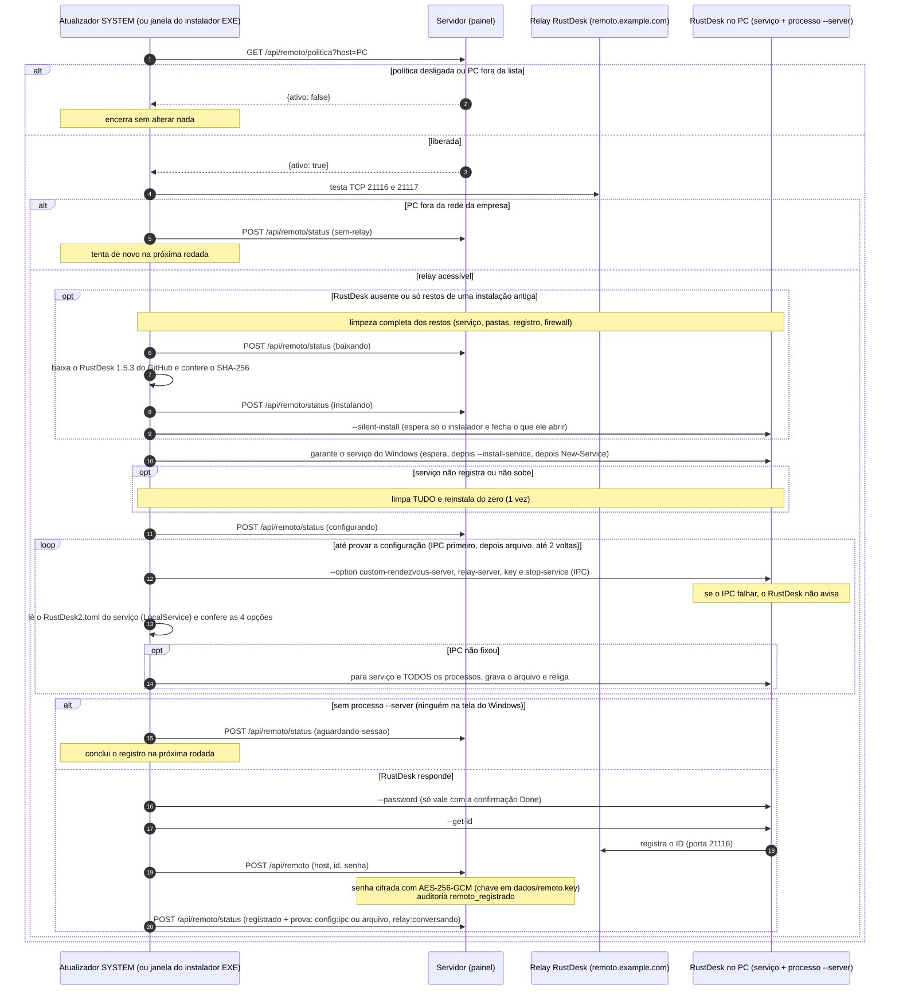

#### Conectar a uma máquina pelo painel

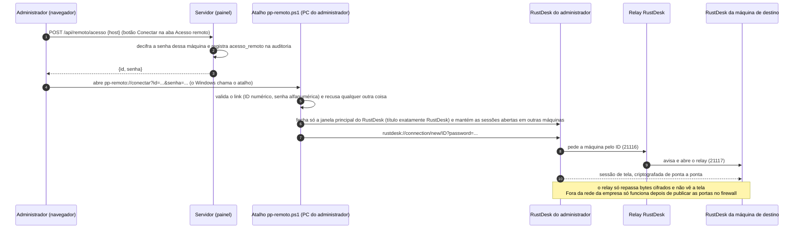

#### Classificação automática de sites e programas

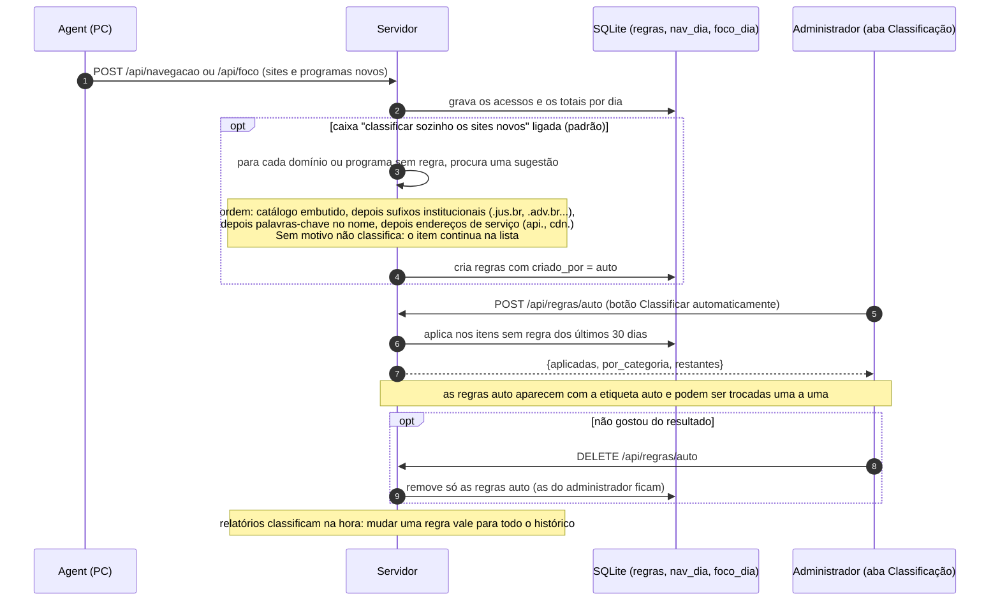

### 3.2. Estrutura de diretório

```
Servidor/
  fonte/                 código do servidor PHP (vai para a hospedagem)
    index.php            roteador único (agents, painel, API v1)
    .htaccess            tudo passa pelo index.php
    _app/lib/            db, auth, totp, relatorios, relatorio_mensal, relatorio_individual, api_v1, inventario,
                         remoto, batimento, comparativo, backup, alertas, software, resumos, exportacao*, rh, sugestoes ...
    _app/public/         painel: index.html, login.html, app.js, bi.js, relatorio.js, admin.js, inventario.js,
                         remoto.js, software.js, style.css
    _app/dados/          criado no servidor: banco, chaves e backup (fechado ao navegador; NUNCA vai no git)
  Publicar/              publicação por FTPS (Publicar-Servidor.ps1), backup do banco (Backup-Servidor.ps1)
  Gerar-Hospedagem.ps1   monta os zips; Iniciar-Servidor.ps1 liga o servidor local de teste
  credenciais.json       token e senha iniciais (NÃO compartilhe; fora do git)
Agent/                   Detectar-Presenca.ps1, Presenca.psm1, Navegacao.psm1, Atualizador.psm1, Atualizar-Agente.ps1,
                         Install-Agente.ps1, Gerar-Pacote.ps1, Assinar-Atualizacao.ps1, versao.txt, chave-publica.xml
Remoto/                  atalho pp-remoto:// e instalador piloto do RustDesk
Config/                  unidades.json (sub-redes, gateways e MACs; o servidor entrega aos agents)
Docs/                    GUIA-HOSPEDAGEM.md (passo a passo da hospedagem)
Ferramentas/             Backup-Repositorio.ps1 (bundle do git + testes), Backup-Pasta.ps1 (zip da pasta, sem segredos, para o OneDrive)
Testes/                  servidor.test.js, *.Tests.ps1 (Pester), carga/carga.js (simulador de 430 PCs)
.githooks/               post-commit: backup do código + testes em segundo plano
Entregas/                saídas geradas (fora do git): Servidor/, Agente/, Atualizacao/, Publicacoes/ (as 5 mais recentes), ci/
chaves/                  chave PRIVADA do atualizador (fora do git; guarde cópia offline)
2 a 10 - *.bat           atalhos: 2 instalar agent, 3 pacote do agent, 4 pacote do servidor,
                         5 atualização assinada do agent, 6 instalador .exe, 7 configurar publicação,
                         8 publicar no servidor, 9 backup do servidor, 10 backup da pasta do projeto
```

Depois de mudar qualquer código, rode os atalhos 3 e 4 (e o 5 para o agent) para regerar `Entregas/`.

### 3.3. Segurança do painel

- Login próprio (`/login`), senha com hash (bcrypt), sessão por cookie `HttpOnly` + `SameSite=Strict` (12 h), proteção CSRF nas escritas, bloqueio de 15 min após 5 senhas erradas.
- **Administrador**: tudo. **Gestor**: só consulta e exporta (não classifica sites, não vê/gera a exportação de acessos detalhados, não gerencia usuários).
- O primeiro administrador é criado a partir de `painel_user` / `painel_pass` do `config.php`. Depois disso a senha vive no banco: troque pelo painel ("Trocar senha"). Alterar `painel_pass` no config **não** muda mais a senha.
- O token do agent (um só para todos os PCs) só permite **enviar** dados e baixar `unidades.json`; não abre o painel.

#### Proteções do painel (servidor exposto na internet)

Camadas, da primeira à última linha de defesa:

1. **Verificação em duas etapas (2FA/TOTP).** Cada usuário ativa pelo botão "Ativar verificação em 2 etapas" (aplicativo autenticador: Microsoft/Google Authenticator, Authy). No login, depois da senha, pede o código de 6 dígitos. Cada código só vale uma vez, e há 8 códigos de recuperação de uso único. Com `'exigir_2fa' => true`, ninguém usa o painel sem ativar; **para administradores é obrigatório por padrão** (`exigir_2fa_admin`, ligado desde o servidor de 24/11/2026). **Senhas:** mínimo de 12 caracteres, sem o nome de usuário, sem senhas comuns e sem repetição de um caractere só. Um administrador pode resetar o 2FA de outro em Administração → Usuários. Se o único administrador perder o acesso: `redefinir_senha_admin` no `config.php` (também desliga o 2FA dele).
2. **Limite de tentativas.** Por conta: 5 erros bloqueiam 15 min. Por IP: `login_max_falhas_ip` (padrão 20) falhas em 15 min bloqueiam o IP, mesmo com a senha certa, o que impede travar o administrador de propósito sem custo para o atacante.
3. **Auditoria** (Administração → Auditoria, retenção `retencao_auditoria_dias`, padrão 365): entradas, falhas, bloqueios, saídas, exportações de CSV (com período), alterações de regras/usuários/colaboradores, trocas de senha e eventos de 2FA, sempre com IP. Senhas e códigos nunca são gravados.
4. Já existentes: senha com hash (bcrypt), cookie `HttpOnly` + `SameSite=Strict`, CSRF, CSP, pasta `_app` bloqueada, perfis administrador/gestor.

Atrás de proxy/CDN, informe `'ip_header' => 'HTTP_X_FORWARDED_FOR'` para os IPs (limite de tentativas e auditoria) serem os do cliente real; sem isso é usado o `REMOTE_ADDR`.

Ordem sugerida: todos ativam o 2FA e, depois, ligue `'exigir_2fa' => true`.

**Endurecimento da auditoria de segurança (servidor 2.0, banco versão 17):**

- **2FA só para administradores:** `'exigir_2fa_admin' => true` obriga os administradores a ativar o 2FA (gestores continuam livres). Fica desligado por padrão para ninguém ser surpreendido: quem ainda não ativou só alcança a tela de configuração do 2FA.
- **Reconfirmar a senha em ações sensíveis:** apagar leituras ("recomeçar do zero"), excluir colaborador, criar token da API, criar/alterar usuário e ver a senha do acesso remoto pedem a senha de novo (e o código do 2FA, se ativo). A confirmação vale 5 minutos, só naquela sessão, e erros são limitados. O painel abre a janela sozinho.
- **Bloqueio por IP + usuário:** 5 erros da mesma origem para o mesmo login bloqueiam só aquela origem por 15 minutos, então um desconhecido não tranca a conta do administrador. A conta só é bloqueada de verdade depois de 30 falhas de qualquer origem.
- **Trocar a senha derruba as outras sessões** abertas do mesmo usuário.
- **HSTS** (`Strict-Transport-Security`, 1 ano, sem subdomínios) nas respostas por HTTPS.
- **`/health` público enxuto:** só `ok`, `versao` e `sqlite`. O diagnóstico completo (OpenSSL, cabeçalho de autorização) exige o token do agent.
- **Gestor não vê dados do RH:** cargo, centro de custo e jornada só aparecem para administradores.
- **Segredo do 2FA cifrado (banco versão 18):** fica no banco como `e1:...` (AES-256-GCM, com a mesma chave `dados/remoto.key` do acesso remoto). Quem copiar só o `.sqlite` não consegue gerar os códigos. O que já estava em texto foi cifrado na migração, sem ninguém reconfigurar o aplicativo. Perder o `remoto.key` obriga a resetar o 2FA dos usuários, então ele entra no mesmo backup que o banco.
- **Token próprio por máquina (agent 1.5.0 + servidor):** o token do instalador passa a ser só de *cadastro*. Na primeira rodada do atualizador (SYSTEM), cada PC chama `POST /api/agente/registrar` e troca esse token por um `ppm_...` que o servidor só aceita para o host dele (se o corpo disser outro host, 403). Assim, quem lê o `agente.json` de um PC não fala em nome dos outros. Em **Administração → Segurança dos agents** aparecem quantas máquinas já trocaram e quais ainda não. Enquanto houver máquina sem troca, o token de cadastro continua valendo para envio (nada fica sem sinal). Quando todas trocarem, o botão **Desligar token de cadastro para envio** fecha a porta: o token de cadastro passa a servir só para cadastrar máquina nova e para baixar a atualização do agent. Uma máquina que já tem token próprio não pode ser recadastrada por quem tem o token de cadastro: reinstalar um PC exige um administrador clicar em liberar (`DELETE /api/agentes/tokens?host=`, com a senha reconfirmada).

## 4. Variáveis de ambiente

O sistema não usa um arquivo `.env` no servidor: a configuração fica em `_app/config.php` (que **nunca** vai no git nem é sobrescrito pela publicação). O PHP também lê a variável de ambiente `PRESENCA_CONFIG` com o caminho de outro arquivo de configuração (usada nos testes e no servidor local). No PC, o agent lê o `agente.json`.

### 4.1. `_app/config.php` (servidor)

Obrigatórias: `agent_token` (mínimo 16 caracteres; é o **token de cadastro** dos agents), `painel_user` e `painel_pass` (o primeiro administrador, criado só se não houver usuários). As demais são opcionais:

| Chave | Padrão | Para quê |
|---|---|---|
| `dados_dir`, `unidades_file`, `public_dir` | pastas de `_app` | onde ficam banco/chaves/backup, o `unidades.json` e o painel |
| `fuso` | `America/Sao_Paulo` | fuso dos relatórios e dos dias |
| `feriados` | `[]` | lista `'AAAA-MM-DD'` excluída dos dias úteis (relatórios e alertas) |
| `online_min` | 45 | minutos sem leitura até o PC virar "Sem sinal" |
| `servidor_online_min` | 15 | minutos sem batimento até o servidor virar "Fora do ar" |
| `presenca_min_leituras`, `presenca_pct_min`, `parcial_abaixo_leituras` | 3, 50, 12 | regras de presença do dia e de dia "Parcial" |
| `comparativo_min_dias` | 3 | mínimo de dias em cada modo no Home × Presencial |
| `jornada_horas` | 8 | jornada padrão (cada pessoa pode ter a sua pelo cadastro do RH) |
| `relatorio_metas` | metas validadas | sobrescreve as metas do relatório (`score`, `tempo_ativo_h`, `disponibilidade_pct`, `ocioso_min`, `produtivo_pct`, `neutro_pct`, `improdutivo_pct`) |
| `retencao_dias`, `retencao_nav_dias`, `retencao_foco_dias`, `retencao_agregados_dias`, `retencao_auditoria_dias` | 90, 30, 60, 400, 365 | quantos dias cada tipo de dado fica no banco |
| `sessao_horas` | 12 | validade da sessão do painel |
| `exigir_2fa` / `exigir_2fa_admin` | `false` / `true` | 2FA obrigatório para todos / só para administradores |
| `login_max_falhas_ip` | 20 | falhas de login por IP em 15 min antes de bloquear o IP (0 desliga) |
| `ip_header` | vazio | atrás de proxy/CDN: `HTTP_X_FORWARDED_FOR`. Vazio usa `REMOTE_ADDR` |
| `redefinir_senha_admin` | — | uso único: redefine a senha do administrador e desliga o 2FA dele |
| `sqlite_wal` | `true` | `false` desliga o modo WAL (discos de rede) |
| `backup_snapshot`, `backup_max_mb` | `true`, 4096 | instantâneo diário do banco para o backup |
| `software_max_mb` | 200 | tamanho máximo de um pacote de software (a hospedagem também limita o envio) |
| `alerta_arquivo` | — | grava os alertas em arquivo em vez de enviar e-mail (testes e diagnóstico) |
| `agora_ms` | — | **só para testes**: congela o relógio do servidor |

Alguns ajustes não ficam no arquivo e sim no painel (Administração): e-mail dos alertas, política do acesso remoto, classificação automática, token de cadastro dos agents e usuários.

### 4.2. `agente.json` (cada PC, em `C:\Program Files\PresencaAgente`)

| Chave | Para quê |
|---|---|
| `servidor` | endereço do servidor (`https://presenca.example.com/presenca`) |
| `token` | token de cadastro do instalador; depois da primeira rodada do atualizador vira o **token próprio da máquina** (`ppm_...`) |
| `coletar_navegacao` | `false` desliga a coleta de sites neste PC |
| `coletar_foco` | `false` desliga a coleta de programas em uso |
| `acesso_remoto` | `false` impede a instalação/configuração do RustDesk neste PC |
| `executar_software` | `false` impede este PC de executar instalações pedidas pelo painel (e remove a tarefa `PresencaAgenteSoftware`) |

### 4.3. Arquivos de configuração e segredos no PC de administração (fora do git)

| Arquivo | O que guarda |
|---|---|
| `Servidor/credenciais.json` | token de cadastro e senha inicial do administrador, lidos pelos scripts |
| `Servidor/local/config.php` | configuração do servidor local de teste (criada pelo Iniciar-Servidor.ps1) |
| `%LOCALAPPDATA%\PresencaPP\publicacao.json` | host, usuário e senha do FTP (senha cifrada com DPAPI do seu usuário) |
| `%LOCALAPPDATA%\PresencaPP\backup.json` | pasta de destino dos backups do banco |
| `chaves/atualizador-privada.xml` | chave que assina as atualizações dos agents (guarde cópia offline) |
| `git config --local presenca.backupRepo` | pasta (OneDrive) que recebe o `.bundle` do código |
| `git config --local presenca.hookDesligado` | `1` desliga o gancho de testes/backup depois do commit |

## 5. Infraestrutura e deploy

### 5.1. Hospedagem do servidor

Veja `Docs/GUIA-HOSPEDAGEM.md`. Resumo: `4 - Gerar Pacote do Servidor (hospedagem).bat` → enviar `presenca-atualizacao.zip` por cima da pasta `presenca` (preserva `config.php` e o banco; o banco antigo é migrado sozinho na primeira requisição).

Opções do `_app/config.php` (todas opcionais): `online_min`, `retencao_dias`, `retencao_nav_dias`, `retencao_agregados_dias`, `sqlite_wal` (padrão `true`), `servidor_online_min` (padrão 15), `comparativo_min_dias` (padrão 3), `fuso`, `sessao_horas`, `presenca_min_leituras`, `presenca_pct_min`, `feriados` (lista `'AAAA-MM-DD'`).

### 5.2. Publicação no servidor pelo script (FTPS)

Em vez de subir o zip à mão pelo painel da hospedagem, o script publica por **FTP com criptografia (FTPS)**, com backup, conferência e reversão automática. A senha do FTP **nunca passa pelo chat nem fica em arquivo do projeto**.

**Uma vez só:** rode `7 - Configurar Publicacao no Servidor (uma vez).bat`. Ele lê os sites salvos no FileZilla (host, usuário e senha, esta decodificada na memória e nunca exibida) ou pede os dados, testa a conexão, pede a pasta do painel (confere que tem `index.php` e `_app`) e guarda tudo em `%LOCALAPPDATA%\PresencaPP\publicacao.json`, com a senha criptografada pelo Windows (só o seu usuário neste PC consegue ler). Se o certificado do servidor FTP não bater com o nome (comum em hospedagem compartilhada), ele pergunta se aceita.

**Para publicar:** `8 - Publicar no Servidor.bat` (ou `Servidor\Publicar\Publicar-Servidor.ps1`):

| Comando | O que faz |
|---|---|
| sem parâmetros | publica `Entregas\Servidor\presenca-atualizacao.zip` |
| `-Agente` | publica a atualização assinada do agent (`Entregas\Atualizacao\manifest.json` e `pacote.zip`, em `_app/dados/agente/`) depois de conferir o hash do pacote |
| `-SimularApenas` | só lista o que seria enviado |
| `-Sim` | não pergunta "PUBLICAR" (para quando o administrador já autorizou) |
| `-Reverter <pasta>` | volta a versão anterior com a cópia guardada em `Entregas\Publicacoes\...\anterior` |

**Segurança e proteções:** nunca envia `config.php`, a pasta `_app\dados` (banco e chaves) nem arquivos `.key`, `.sqlite` e `.pem` (o filtro vale mesmo que o pacote traga). A senha vai ao curl pela entrada padrão (não aparece na linha de comando). Antes de trocar cada arquivo, baixa a cópia atual (backup); o `index.php` vai por último (a versão antiga continua no ar se o envio cair no meio). No fim confere o `/health` (ou `/api/agente/versao` no modo `-Agente`) e, **se falhar, reverte sozinho**. Cada publicação grava `publicacao.log` e a pasta `anterior` em `Entregas\Publicacoes\AAAAMMDD-HHMMSS-servidor`. Só FTP e FTPS por enquanto (SFTP não, o curl do Windows não o tem).

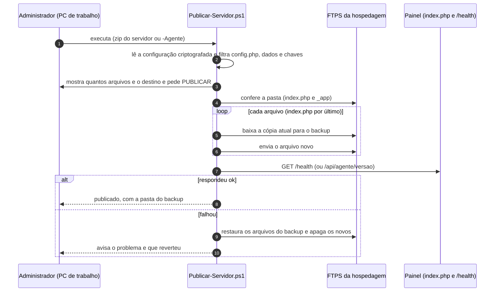

### 5.3. Agent: instalação e atualização

Como Administrador em cada PC (ou via Intune/GPO):

```powershell
.\Install-Agente.ps1 -Servidor https://SEU-SERVIDOR -Token SEU_AGENT_TOKEN
.\Install-Agente.ps1 -Desinstalar
```

Roda a cada 5 min, ao trocar de rede (eventos 10000/10001/4004), no logon e ao desbloquear a tela; 24h, todos os dias, no contexto do usuário. Sem internet, guarda até 500 leituras de presença numa fila local; os sites são relidos do histórico e reenviados (o ponto de leitura só avança depois que o servidor confirma). Teste sem enviar nada:

```powershell
powershell -ExecutionPolicy Bypass -File .\Detectar-Presenca.ps1 -Detalhado -IgnorarHorario -SoMostrar
```

Requisitos para os sites: Windows 10/11 (usa a `winsqlite3.dll` do próprio Windows; nada a instalar). O histórico do Chrome/Edge é copiado para uma pasta temporária, lido e apagado a cada execução.

#### Relatório completo em Excel

Botão **Relatório completo (Excel)** no Painel BI (usa o período escolhido). Um `.xlsx` com abas filtráveis, cabeçalho fixo e durações/datas/percentuais como valores de verdade (somam e ordenam no Excel):

| Aba | Uma linha por | Principais colunas |
|---|---|---|
| **Resumo por colaborador** | colaborador | dias presenciais/remotos/parciais/sem registro, tempo de navegação, produtivo/improdutivo/neutro, % |
| **Dia a dia** | colaborador × dia útil | situação do dia, unidade, computador, primeira/última leitura, tempo por tipo de uso, sites que mais usou |
| **Localização** | trecho (mesmo local, sem lacuna > 30 min) | computador, colaborador, início, fim, duração, local, unidade, VPN. Cobre no máximo os 14 últimos dias do período |
| **Acessos** (só administrador) | acesso a site | data/hora, colaborador, computador, site, tipo de uso, título da página, duração (até 100 mil linhas) |

Fica de fora, de propósito, o que vinha vazio ou sem uso nos relatórios de referência (endereço "Pendente", modalidade "Indeterminado", hierarquia "Indefinido") e as URLs completas com número de processo/hash/token. Cada exportação fica na auditoria. Os CSVs antigos continuam disponíveis.

#### Programas em uso (a partir do agent 1.2.0)

- Uma tarefa a mais, **PresencaAgenteFoco** (no contexto do usuário, sem janela), olha a janela em primeiro plano a cada 5 s e registra **quanto tempo cada programa ficou na frente** (Word, Excel, Outlook, Teams, Explorador…) e o **título da janela**. Não conta tela bloqueada nem 5 min sem teclado/mouse. Não captura o conteúdo das janelas. Em navegadores só o programa conta (os sites já vêm do histórico, sem um registro por aba).
- O agent de 5 em 5 min envia a fila ao servidor. Sem rede, a fila fica em `%LOCALAPPDATA%\PresencaPP` e é reenviada, sem duplicar (cada segmento tem identidade única). O coletor guarda um ponto de segurança por minuto: se o PC desligar de repente, se perde no máximo cerca de 1 min.
- **Classificação de programas:** aba Classificação → "Programas sem classificação" (Produtivo / Neutro / Improdutivo). Já vêm classificados os mais comuns (Office, Acrobat, Teams → produtivo; Roblox, Steam, Spotify, Discord → improdutivo; Explorer etc. → neutro). Navegadores ficam fora: valem os sites.
- **Desligar:** em `C:\Program Files\PresencaAgente\agente.json` use `"coletar_foco": false` (tudo) ou `"coletar_titulos_janela": false` (coleta o programa, sem o título).
- **Retenção:** segmentos brutos por 60 dias (`retencao_foco_dias` no `config.php`); o resumo por dia/programa por 400 dias.
- No relatório Excel: colunas novas no Resumo e no Dia a dia (**tempo ativo no PC**, programas por tipo de uso, **% produtivo geral** = sites + programas), aba **Programas** (colaborador × dia × programa, pronta para tabela dinâmica/BI) e, para administradores, **Foco detalhado**.

#### Inventário de máquinas (a partir do agent 1.3.0)

Aba **Inventário**: o mesmo controle do "Relatório de Ativos" (Nome, Status, Fabricante, Número de série, Tipo, Modelo, Nome alternativo do usuário, Número de inventário, Localização, Comentários), agora com o que o agent coleta sozinho.

- **Coleta automática** (1x por dia e quando o agent atualiza, sem o usuário perceber): fabricante, modelo, número de série, tipo (notebook/desktop/servidor), Windows (edição, versão, build, arquitetura, data de instalação), processador, memória, discos (SSD/NVMe/HDD e tamanho), espaço livre em C:, IP local, MAC, domínio, BIOS e último boot. O **IP de saída** e o **último usuário logado** vêm das leituras de presença. Não coleta arquivos nem lista de programas instalados.
- **O número de inventário é o nome da máquina** (MTZ0779, SP00013…): é assim que a máquina que envia dados encontra o cadastro. Máquinas cujo nome não bate com a planilha aparecem como **"Agente sem cadastro"**.
- **Importar o CSV atual:** botão "Importar CSV" (administrador), no modelo do Relatório de Ativos (`;`, cabeçalho com acento, comentários com quebra de linha). Por padrão só preenche o que está vazio; ao confirmar "sobrescrever", o CSV manda nos campos de controle (status, responsável, localização, comentários). **O que o agent coletou nunca é sobrescrito pelo CSV.** Importar de novo o mesmo arquivo não muda nada. Testado com o relatório de 16/11/2026 (601 ativos, com os mesmos totais por status).
- **Estoque, reparo e máquinas sem agent** ficam no inventário normalmente (status, responsável, localização e comentários são manuais). "Novo ativo" cria um equipamento antes de ele ter agent.
- **Alterações de hardware** (troca de memória, disco, Windows, placa) viram histórico por máquina e uma aba no Excel.
- **Exportar:** CSV com as 10 primeiras colunas **idênticas ao modelo** (as colunas do agent vêm depois) e Excel com a aba "Ativos" e "Alterações de hardware". Filtros rápidos: sem contato há +7 dias, menos de 8 GB, com HDD, agente sem cadastro.
- Quem edita é só o administrador; o gestor consulta e exporta. Tudo fica na auditoria.

#### Servidores

`SRV-B` e `SRV-A` vêm marcados como servidor e **ficam fora das contas por colaborador** (presença, sites e programas deles não somam para quem estava logado; o botão "Recalcular resumos sem servidores" em Administração refaz os dias que ainda têm dados brutos). No painel (Presença agora) aparece **"Último usuário: …"** no lugar do colaborador, com a etiqueta "Servidor"; na aba Localização do Excel, "Servidor - último usuário: …". Para marcar ou desmarcar outra máquina: abra-a em Presença agora → "Marcar como servidor" (administrador).

**Disponibilidade dos servidores (agent 1.4.9).** Servidor Windows fica ligado sem ninguém logado, e a tarefa do usuário (que gera as leituras) não roda, então ele aparecia "Sem sinal". Para as máquinas **marcadas como servidor**, o atualizador SYSTEM cria a tarefa `PresencaAgenteBatimento` (a cada 5 min e no boot, sem depender de usuário) que só avisa "estou no ar" e a hora em que o Windows ligou. No painel o servidor passa a mostrar **No ar** / **Fora do ar** (sem sinal há mais de 15 min, `servidor_online_min` no `config.php`), com "ligado desde …", e o último usuário continua visível. Marcou um servidor novo? A tarefa é criada na próxima rodada do atualizador (até 6 h). Desmarcou? A tarefa é removida na mesma rodada.

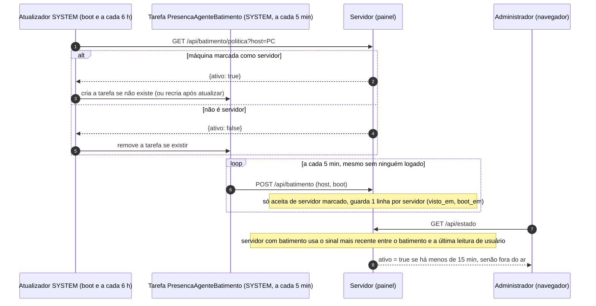

#### Dados completos para o BI (sem perder nada)

- O **IP de saída** (o que o servidor enxerga na conexão do agent) é gravado em cada leitura e aparece nas abas Localização e Dia a dia, e no CSV de leituras. Leituras anteriores à versão do servidor que introduziu o campo ficam sem IP.
- Cada aba do Excel tem teto de 100 mil linhas e **avisa na última linha** se foi atingido. Para o período inteiro, sem limite, use Administração → **Exportar dados completos (CSV)**: acessos a sites, programas em uso e leituras de localização, gerados em fluxo.
- **Retenção no servidor** (`config.php`): leituras brutas 90 dias, acessos a sites 30 dias (`retencao_nav_dias`), programas brutos 60 dias; os resumos diários (presença, sites e programas) ficam 400 dias. O que passa disso é apagado (1 vez por dia, em lotes; ver "Escala e capacidade"). Para o BI, baixe os CSVs completos todo mês, ou aumente esses números se a hospedagem tiver espaço.

#### Instalador .exe e desinstalação pelo Windows

- Atalho **6 - Gerar Instalador EXE.bat** (precisa do Inno Setup: `winget install JRSoftware.InnoSetup`) gera `Entregas\Agente\Instalar-Agente-PP-<versão>.exe`, que leva servidor e token (uso interno). Dois cliques instalam (pede administrador); silencioso: `Instalar-Agente-PP-x.y.z.exe /VERYSILENT /SUPPRESSMSGBOXES`.
- O agent aparece em **Configurações → Aplicativos** (e no Painel de Controle) como "Agente de Presenca", com **Desinstalar**. Isso remove as duas tarefas, `C:\Program Files\PresencaAgente` e `C:\ProgramData\PresencaAgente` (os dados locais de cada usuário em `%LOCALAPPDATA%\PresencaPP` ficam).
- Quem instalou pelo `.zip`/script também ganha a entrada: o `Install-Agente.ps1` cria, e o atualizador (a partir da 1.1.5) cria nos PCs já instalados. Se depois rodar o `.exe` por cima, a entrada do `.exe` passa a valer e a outra é removida.
- Estrutura de pastas igual nas duas formas de instalar (`Program Files\PresencaAgente`, `ProgramData\PresencaAgente`), então o `.exe` pode ser instalado por cima de um agent já instalado.

#### Atualização automática do agent

- O agent informa a versão (`Agent\versao.txt`) ao painel (etiqueta "agent vX" em Presença agora).
- Uma segunda tarefa agendada, **PresencaAgenteUpdate** (conta SYSTEM, no boot e a cada 6 h), consulta `/api/agente/versao`. Se houver versão **maior**, baixa o pacote e **só instala se a assinatura RSA/SHA-256 conferir** com a `chave-publica.xml` instalada no PC. Pacote com arquivo fora da lista (ex.: `agente.json`), versão igual/menor ou erro de sintaxe é descartado. Depois de instalar, testa o agent; se falhar, **desfaz (rollback)** e não tenta a mesma versão de novo. Log: `C:\ProgramData\PresencaAgente\atualizador.log`.
- Se o SYSTEM não conseguir baixar (proxy com autenticação), o próprio agent do usuário deixa o pacote em `C:\ProgramData\PresencaAgente\entrada`; a assinatura é exigida do mesmo jeito.
- **Publicar uma versão nova:** edite o código, aumente o número em `Agent\versao.txt`, rode o atalho **5 - Gerar Atualizacao do Agente.bat** (usa a chave privada) e suba `Entregas\Atualizacao\pacote.zip` e `manifest.json` para `_app/dados/agente/` na hospedagem.
- **Chave privada** (`chaves\atualizador-privada.xml`, fora do git): guarde offline e faça cópia. Quem a tiver consegue rodar código nos PCs; o servidor nunca a recebe. Perder ou trocar a chave exige reinstalar todos os agents. Para assinar de outro local: `Assinar-Atualizacao.ps1 -Chave E:\cofre\atualizador-privada.xml`.
- Agents instalados antes do atualizador precisam de **uma** reinstalação manual com o `Pacote-Agente.zip`.

### 5.4. Acesso remoto (RustDesk)

Acesso remoto às máquinas pelo painel, sem custo: relay próprio do RustDesk (`hbbs`/`hbbr`) numa VM Debian na rede interna
(`remoto.example.com`, portas 21115–21117). **Por enquanto só funciona dentro da rede da empresa/VPN**; para acessar de fora
é preciso publicar essas portas (chamado ao firewall) e o DNS público.

- **Liberação:** Administração > *Acesso remoto*: `Desligado` (padrão, nenhuma máquina é alterada), `Só as máquinas da lista` ou `Todas`.
- **Agent:** o atualizador (SYSTEM) consulta a política; se a máquina está liberada e o relay responde, instala o RustDesk 1.5.3 (hash conferido), garante o serviço do Windows
  (se ele não registra ou não sobe, **limpa tudo e reinstala do zero**), configura o relay **em camadas e com prova** e gera **uma senha aleatória por máquina** (guardada com DPAPI).
  Desligável por PC em `agente.json`: `"acesso_remoto": false`.
  - **Como a configuração do relay é feita e provada** (`Set-ConfigRelay`): o RustDesk guarda a configuração do SYSTEM em `C:\Windows\ServiceProfiles\LocalService\AppData\Roaming\RustDesk\config\RustDesk2.toml`,
    e `--option`/`--password` falam por IPC com o processo `--server`, **sem avisar quando falham** (e o `--server` só existe com alguém na tela do Windows). Por isso: (1) tenta o IPC;
    (2) **confere o resultado no arquivo** (a prova de que persistiu); (3) se não fixou, para o serviço e todos os processos, grava o arquivo, religa e confere de novo (até 2 voltas);
    (4) só declara sucesso com as 4 opções provadas. A senha é reaplicada a cada rodada e só vale se o RustDesk confirmar (`Done!`).
  - **Estados** que o painel mostra: baixando, instalando, configurando, registrado/ok, fora da rede (`sem-relay`), aguardando alguém entrar no Windows (`aguardando-sessao`),
    prazo esgotado (continua na próxima rodada; o fluxo tem prazo de 8 min por causa do limite de 10 min da tarefa) e as falhas (instalação, serviço, config, senha, ID, envio).
    O detalhe de cada máquina informa o canal usado (`config:ipc`/`config:arquivo`) e se o relay já está conversando com ela.
  - Diagnóstico local: `C:\ProgramData\PresencaAgente\remoto.log` (usuário, sessão, cada tentativa e o que foi lido).
- **Servidor:** a senha fica cifrada (AES-256-GCM) com a chave `dados/remoto.key` (arquivo separado do banco; **faça backup dos dois juntos**).
  Só administrador vê a senha, uma máquina por vez, e cada consulta vai para a Auditoria (`acesso_remoto`).
- **Painel:** o menu **Acesso remoto** (só administrador) mostra a situação do RustDesk em **todas as máquinas com agent**: cartões clicáveis por situação (prontas, instalando, aguardando, com falha, fora da rede, sem informação), busca por máquina, usuário ou ID, filtro "só online" e, em cada linha, **Conectar**, **Copiar senha** e **Detalhes**. Atualiza sozinha a cada 30 s.
  A liberação (Desligado / só a lista / todas) fica no fim dessa aba. A gaveta do Inventário continua com os mesmos botões.
  Em cada PC de quem acessa, instale o RustDesk e rode **uma vez** `Remoto\Instalar-Atalho-Remoto.ps1` (sem administrador): ele registra o atalho `pp-remoto://`, que o botão usa.
  O link nativo `rustdesk://` não serve porque o RustDesk o ignora quando a janela dele já está aberta; o atalho fecha essa janela (só a do usuário) e abre a conexão.
- `/health` mostra `openssl: true/false`: sem OpenSSL com AES-GCM a hospedagem não consegue guardar as senhas.
- O código do agent fica dentro de `Presenca.psm1` de propósito: o atualizador dos agents já instalados só aceita os arquivos da lista fixa.

### 5.5. Backup do banco, das chaves e do código

**Banco (servidor) → PC.** O servidor gera sozinho, no primeiro envio do dia (uma vez a cada ~22 h, depois de responder ao agent), **uma** cópia consistente do banco em `_app/dados/backup/presenca-snapshot.sqlite` (pasta fechada ao navegador). O atalho **9 - Backup do Servidor.bat** (`Servidor\Publicar\Backup-Servidor.ps1`) baixa essa cópia por FTPS, confere (cabeçalho SQLite e `PRAGMA integrity_check` se o PHP do PC tiver SQLite), comprime no PC e **só então apaga a cópia do servidor**. Assim o disco da hospedagem carrega uma cópia a mais por poucas horas e nunca acumula histórico.

Para não estourar o disco: a cópia só é feita se sobrarem 1,5 × o tamanho do banco livres; pula se o banco passar de `backup_max_mb` (padrão 4096, avisa na Administração); e segura a vez de escrever só durante a cópia (uma fração de segundo por centenas de MB). Desligar: `'backup_snapshot' => false` no `config.php`.

No PC ficam as **14 cópias diárias mais novas e uma por semana nas 8 semanas anteriores** (`presenca-AAAAMMDD-HHMM.sqlite.gz`, ~1/4 do tamanho do banco) e, na subpasta `chaves`, as versões de `remoto.key` e `pseudonimo.key` (uma nova só quando a chave muda). Primeira vez: `9 - Backup do Servidor.bat -Destino D:\Backups\Presenca`; para rodar todo dia às 03:30: `... -Agendar` (a tarefa usa a configuração de FTP do seu usuário, então só roda com você logado). Em **Administração → Backup do banco** aparecem o tamanho do banco, a última cópia e o botão "Gerar cópia agora".

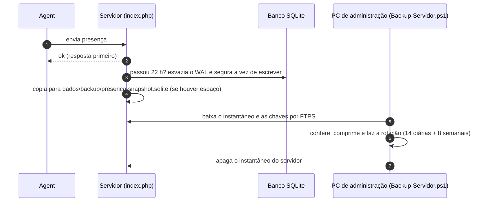

**Restaurar:** descompacte o `.gz` (7-Zip), ponha o arquivo como `_app/dados/presenca.sqlite` (com o sistema parado) e coloque as `chaves` correspondentes em `_app/dados/`.

**Código (git) → OneDrive.** `Ferramentas\Backup-Repositorio.ps1 -Pasta "<pasta do OneDrive>"` cria um único `.bundle` (histórico completo, verificado com `git bundle verify`) e guarda as 30 mais novas. Um arquivo só é o formato seguro para o OneDrive (sincronizar uma pasta `.git` ao vivo pode corrompê-la). O gancho `.githooks/post-commit` roda isso depois de cada commit, em segundo plano, **junto com os testes** (a "integração contínua" local): o resultado fica em `Entregas\ci\ultimo.txt` (VERDE ou VERMELHO). Restaurar em outro PC: `git clone presenca-agente-AAAAMMDD-HHMMSS.bundle C:\PresencaAgente`. Desligar o gancho: `git config --local presenca.hookDesligado 1`.

**Pasta do projeto → OneDrive.** O atalho **10 - Backup da Pasta do Projeto.bat** (`Ferramentas\Backup-Pasta.ps1`) grava um zip por dia da pasta do projeto (scripts, atalhos `.bat`, código, documentação e testes) em `<pasta do OneDrive>\Pasta\presenca-pasta-AAAAMMDD.zip`, trocando o de hoje se rodar de novo, e guarda os 14 dias mais novos e um por semana nas 8 semanas anteriores. **Ficam de fora:** `credenciais.json`, `chaves\`, `config.php`, `.env`, bancos, `Servidor\local`, `Entregas\` (os pacotes têm o token dos agents), `.git` (o `.bundle` já cobre) e `node_modules`. Automático de três jeitos: a tarefa **PresencaBackupPasta** do Windows (todo dia às 12:30, criada com `-Agendar`; só roda com o seu usuário logado), o gancho do git depois de cada commit e o botão do atalho. Restaurar: descompactar o zip em uma pasta nova e recolocar os segredos (`credenciais.json`, `chaves\`) a partir da sua cópia offline.

**Chave privada do atualizador** (`chaves\atualizador-privada.xml`, fora do git): guarde uma cópia offline (pendrive ou cofre). Sem ela não dá para publicar atualização assinada dos agents.

### 5.6. Alertas por e-mail

Em **Administração → Alertas por e-mail** você informa o e-mail de destino (ele fica no banco, nunca no código), liga os alertas e pode mandar um e-mail de teste (olhe também o spam na primeira vez). O envio usa o `mail()` da hospedagem.

| Alerta | Quando dispara | Intervalo mínimo |
|---|---|---|
| Queda no envio de presença | Em expediente (seg a sex, 9h às 18h, fuso do servidor, sem os `feriados` do config): há 10 ou mais PCs na base (enviaram nas 2h30 anteriores) e menos da metade enviou nos últimos 30 min | 3 h |
| Falhas de login em sequência | O painel bloqueou uma origem por erros de senha (5 erros do mesmo IP para o mesmo usuário, ou 20 do mesmo IP) | 1 h por IP |

A checagem de queda roda no máximo a cada 10 min, acionada pelos próprios agents e por um verificador externo. Para avisar também quando o **servidor inteiro** cair (quando nenhum agent consegue falar), use um verificador gratuito (por exemplo, o UptimeRobot) apontando para `https://<seu-endereço>/health` e com o seu e-mail: cada verificação também dispara a checagem de queda. Nenhum alerta leva senha, código ou token no texto. Para testes e diagnóstico, `'alerta_arquivo' => 'caminho'` no `config.php` grava os alertas num arquivo em vez de enviar.

### 5.7. Escala e capacidade (430 máquinas)

Medido com um banco sintético (20 máquinas x 30 dias, volumes típicos por máquina) e extrapolado. **Por máquina e por dia:** leituras 33 KB, sites 70 KB, programas 65 KB, resumos 8 KB.

| Quando (430 máquinas) | Tamanho do banco |
|---|---|
| 1 mês | ~2,3 GB |
| 3 meses | ~4,2 GB |
| 13 meses em diante | ~5,3 GB (estabiliza: a retenção apaga o que passa do prazo) |

Conta conservadora (todos os dias da semana, sem folgas). Planeje **~15 GB** livres: o `VACUUM` pede o dobro do arquivo e há cópias de backup (o `.sqlite` comprime ~4x). O tráfego do sistema é ~5 GB/mês.

**O que garante a escala (servidor):**
- **Modo WAL** (`PRAGMA journal_mode=WAL`, ligado sozinho na primeira requisição): o painel lê sem travar os agents. Em teste com 16 processos gravando juntos, 3.200 envios levaram 1,3 s contra 11 s no modo antigo. Se o disco da hospedagem não suportar, o SQLite continua no modo antigo sem erro. Desligar: `'sqlite_wal' => false` no `config.php`. **Backup com WAL:** copie `presenca.sqlite` junto com `presenca.sqlite-wal` e `presenca.sqlite-shm` (ou faça a cópia com o sistema parado).
- **Espera de 15 s** pela vez de gravar (`busy_timeout`), em vez de falhar com "database is locked".
- **Índices só por data** em `navegacao` e `foco` (banco na versão 12): a limpeza não varre mais milhões de linhas.
- **Limpeza 1 vez por dia, em lotes de 5.000 linhas**, por uma única requisição (as demais seguem sem esperar), com limite de 8 s. Se não terminar, continua na próxima requisição. Falha na limpeza nunca vira erro para o agent.

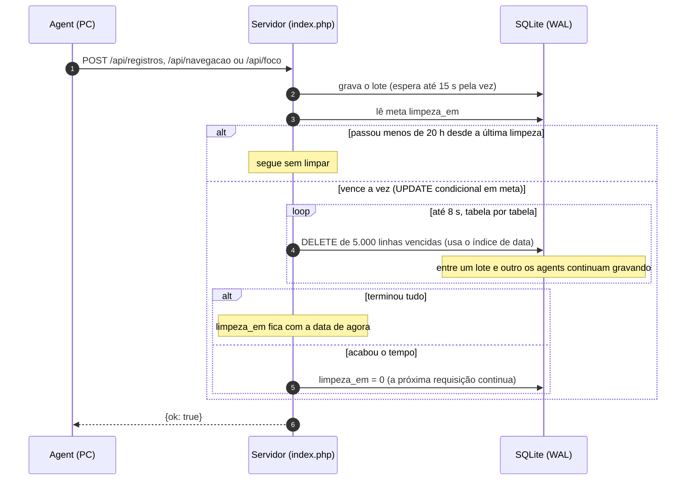

**Quando migrar para um VPS** (2 vCPU, 4 GB de RAM, 50 GB de disco): se a hospedagem limitar CPU ou processos PHP simultâneos, se aparecer "database is locked" no log, ou se relatórios de ano inteiro ficarem lentos (estimativa: 30 dias de sites ~0,7 s com 430 máquinas, 400 dias vários segundos). Disco e tráfego do plano atual (136 GB / 400 GB por mês) sobram.

### 5.8. Teste de carga (430 máquinas simuladas)

`node Testes/carga/carga.js` simula a frota (1 registro + 40 programas em foco + 25 visitas por PC a cada rodada de 5 min) enquanto um painel lê os indicadores. Medido em 24/11/2026 com o servidor PHP embutido (uma requisição por vez, pior que o Apache para leitura):

| Cenário | Chegadas | Requisições | p50 | p95 | Erros |
|---|---|---|---|---|---|
| 2 rodadas, os PCs chegam em 150 s (o dobro da densidade real) | 9/s | 2.727 | ~37 ms | ~100 ms | 0 |
| 3 rodadas, todos os PCs em 30 s (10× mais apertado que o real) | 30/s | 3.902 | ~2,0 s | ~6,3 s | 53 (conexões recusadas na fila) |

A carga real (430 PCs × 3 envios a cada 5 min) é **~4,3 requisições/s**: com ~33 ms de serviço por requisição, um processo só usa ~14% da capacidade. O volume gravado nesse teste foi ~5 MB por rodada de 430 PCs, o que projeta algo como ~600 MB/dia **no pior caso** (40 itens de foco + 25 visitas por PC a cada 5 min, mais que o agent costuma enviar); o tamanho real aparece em Administração → Backup do banco e deve ser comparado com essa projeção nos primeiros dias.

### 5.9. Políticas de instalação de software nos PCs (agent 1.7.0 ou mais novo)

Em **Políticas de Instalação** (menu Administração, abaixo de Relatório) o administrador cadastra uma política: um instalador (`.msi`, `.exe`), um script (`.ps1`, `.cmd`/`.bat`, `.vbs`) ou um **`.zip`** com vários arquivos (instalador, perfil de configuração, scripts). Cada política tem nome, descrição, nome do software (como em Programas e Recursos), parâmetros silenciosos, **arquivo gatilho** e **desinstalação**. Dá para **instalar ou desinstalar** em máquinas escolhidas e acompanhar o resultado de cada uma (aguardando, executando, instalado/desinstalado, falhou, com o código de saída e o fim da saída), ou ligar a **aplicação automática**: todo PC que combine com o alvo (e ainda não tenha o programa) recebe a instalação sozinho, inclusive os que entrarem depois. Serve para instalar programa, rodar um script de configuração, importar um perfil (VPN) ou distribuir um certificado público (`.cer`) por script. **Não há certificado com chave privada (`.pfx`) nesta versão.**

- **Pacote zip:** o painel lê o diretório do zip no navegador e deixa escolher qual arquivo executar (por exemplo `installer/instalar.cmd`); o script roda na pasta onde o zip foi extraído, então enxerga os arquivos ao lado (`%~dp0config\perfil.ovpn`). O zip é extraído com validação de todos os nomes antes de gravar qualquer coisa (sem `..`, caminho absoluto, `:`, `\`, nome reservado do Windows), no máximo 2000 arquivos e 2 GB gravados.
- **Arquivo gatilho:** caminho completo com variáveis (`[programfiles]`, `[programfiles(x86)]`, `[programdata]`, `[windir]`, `[system32]`, `[systemdrive]`). Se o arquivo já existe, a instalação é **ignorada** (resultado "ignorada", sem baixar nada). Se o instalador terminar sem erro e o gatilho não aparecer, a tarefa **falha** (o gatilho é conferido, não só confiado).
- **Desinstalação** (assinada junto com o pacote): *pelo código MSI* (`msiexec /x {GUID}`), *pelo nome* em Programas e Recursos (nome exato, com `*` como curinga; achou mais de um programa, falha; não achou, ignora; programa MSI usa `msiexec /x`; os demais usam o `QuietUninstallString`, ou o `UninstallString` somados aos parâmetros silenciosos informados, e sem forma silenciosa não executa) ou *por script do pacote*.
- **Aplicação automática:** o servidor cria a tarefa de instalação quando o agent pergunta por tarefas (a cada 15 min e logo depois da rodada normal do agent, então um PC novo recebe em poucos minutos). Alvo opcional por nome de máquina com `*` e `?` (ex.: `MTZ*, NOTE-?`; vazio = todas). Servidores marcados no painel ficam de fora. Cada máquina recebe uma vez; se falhar, até 3 tentativas com 6 h entre elas; tarefa cancelada não volta.

**Segurança.** O servidor não cria nem altera pacotes por conta própria: quem assina é o administrador, **no navegador**, com a mesma chave do atualizador (`chaves\atualizador-privada.xml`). O arquivo da chave é lido pelo navegador, vira uma chave não exportável do WebCrypto e fica só na memória da aba (some ao fechar, recarregar ou clicar em "Esquecer chave"); nunca vai ao servidor nem ao armazenamento do navegador. A assinatura cobre um **manifesto** (nome, descrição, tipo, nome do arquivo, SHA-256, tamanho, parâmetros, arquivo a executar no zip, gatilho, desinstalação e um identificador único). O agent só executa se a assinatura conferir com a `chave-publica.xml` embutida **e** o arquivo baixado tiver o mesmo SHA-256 e tamanho. Assim, quem invadir o painel ou o banco consegue no máximo repetir (instalar ou desinstalar) pacotes que a empresa já assinou; a política de aplicação (automática, alvo) não é assinada, porque só decide *quando* um pacote já assinado roda. Desinstalar só é possível se a desinstalação foi assinada no pacote. Regras adicionais: só vale o **token próprio da máquina** (o token de cadastro não baixa nem informa nada); cada máquina só vê e baixa o que é dela; a pasta de trabalho no PC é fechada para SYSTEM e administradores (um usuário comum não troca o arquivo entre a conferência e a execução); cadastrar, disparar, ligar a aplicação automática, cancelar, repetir e excluir pedem a confirmação de senha e ficam na auditoria; o processo roda com prioridade baixa, sem janela, com tempo máximo de 1 h.

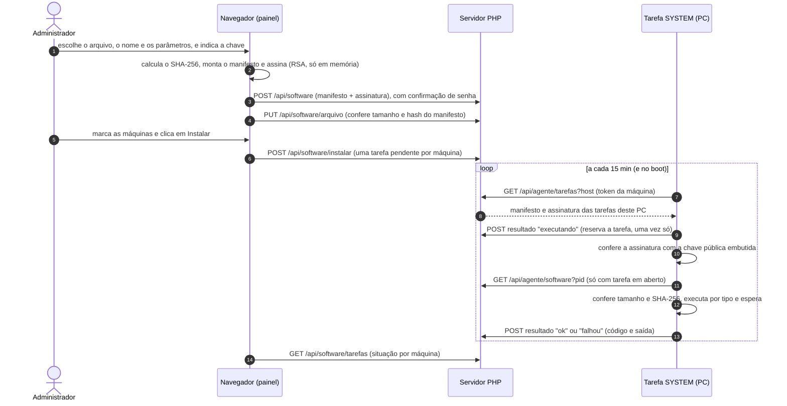

**Como cada tipo roda** (como SYSTEM, sem janela, na pasta de trabalho do pacote): `.msi` com `msiexec /i`; `.exe` com os parâmetros informados; `.ps1` com `powershell -ExecutionPolicy Bypass -File`; `.cmd`/`.bat` com `cmd /c`; `.vbs` com `cscript //nologo`. Os códigos 0, 3010 e 1641 contam como instalado (os dois últimos avisam que falta reiniciar). Para MSI o painel sugere `/qn /norestart`; instaladores `.exe` precisam dos parâmetros silenciosos do fabricante.

**Detalhes.** O arquivo do pacote fica em `_app/dados/software/` (fechado ao navegador) e **não entra no backup do banco**: guarde o original do instalador. O histórico das tarefas (banco v20, tabelas `pacotes` e `tarefas`) fica 1 ano. Uma tarefa "executando" há mais de 2 h (PC desligou no meio) volta à fila; por isso o script ou instalador deve poder rodar de novo sem estragar nada. Mudar parâmetros, gatilho ou desinstalação de um pacote é cadastrar outro, porque a assinatura cobre o arquivo e esses campos juntos. O limite de tamanho é `software_max_mb` (padrão 200 MB) e o envio também esbarra no limite da hospedagem.

## 6. Guia do desenvolvedor

### 6.1. Setup e modos de execução (localmente/produção)

**Pré-requisitos no PC de desenvolvimento:** Windows 10/11, PHP 8.3 (`winget install PHP.PHP.8.3`), Node.js 18 ou mais novo (`winget install OpenJS.NodeJS.LTS`), Pester 3.4 (já vem no Windows PowerShell 5.1) e Git.

**Modo local (teste).** O atalho `1 - Iniciar Servidor.bat` (ou `Servidor\Iniciar-Servidor.ps1`) liga o **mesmo código PHP da hospedagem** no servidor embutido do PHP em `http://localhost:3000`. Na primeira vez cria `Servidor\local\config.php` com token e senha. Para apontar para outra configuração: variável `PRESENCA_CONFIG`. O servidor embutido atende uma requisição por vez (suficiente para desenvolver). Para ver o painel no navegador, entre com o usuário do `config.php`; com `exigir_2fa_admin` ligado (padrão), desligue-o no `config.php` local ou ative o 2FA na primeira entrada.

```powershell
$env:PRESENCA_CONFIG = 'C:\caminho\config.php'
php -S 127.0.0.1:8765 -t Servidor\fonte Servidor\fonte\index.php
```

**Agent local.** `2 - Instalar Agente neste PC.bat` instala o agent apontando para o servidor local (ou use `Detectar-Presenca.ps1 -Detalhado -IgnorarHorario -SoMostrar` para ver o que ele coletaria sem enviar).

**Modo produção.** O servidor roda na hospedagem (hospedagem compartilhada) em `https://presenca.example.com/presenca`; os agents instalados nos PCs falam com ele. Fluxo de uma mudança:

1. editar o código e rodar os testes (6.2);
2. atalho `4` (pacote do servidor) e `8 - Publicar no Servidor.bat` (simula, publica por FTPS, confere o `/health` e reverte sozinho se falhar);
3. se o agent mudou: subir `Agent\versao.txt`, atalho `5` (atualização assinada) e `8 ... -Agente`; os PCs atualizam sozinhos em até 6 horas.

Na primeira vez, o atalho `7 - Configurar Publicacao no Servidor (uma vez).bat` guarda o acesso FTP (cifrado). O backup do banco é o atalho `9`.

### 6.2. Testes

```powershell
Invoke-Pester .\Testes                       # agent e scripts (Pester 3.4+)
node --test Testes/servidor.test.js          # servidor PHP (precisa de php e node)
node Testes/carga/carga.js --maquinas 430    # simulador de carga (medição, fora do node --test)
```

Depois de cada commit, o gancho `.githooks/post-commit` roda a cópia do código e os testes em segundo plano e grava VERDE ou VERMELHO em `Entregas\ci\ultimo.txt`. Convenções: arquivos `.ps1` e `.psm1` só com ASCII (PowerShell 5.1 lê sem BOM como ANSI); migração de banco = subir `VERSAO_BANCO` em `db.php`; todo fluxo novo ganha um diagrama de sequência Mermaid neste README.

### 6.3. Funcionalidades (referência)

#### Classificação automática de sites e programas

Na aba **Classificação** (administrador): **Classificar automaticamente** cria regras para os sites e programas sem regra que o sistema reconhece;
o resto continua na lista "sem classificação" para você decidir.

- **Como decide:** só pelo **nome** do domínio/programa (o servidor nunca visita os sites). Ordem: catálogo embutido (`lib/sugestoes.php`, pensado para um
  escritório de advocacia brasileiro), sufixos institucionais (`.jus.br`, `.gov.br`, `.mp.br`, `.adv.br`, `.not.br` produtivos; `.edu.br`, `.mil.br` neutros),
  palavras-chave no nome (loja/compras, jogos, apostas, filmes/séries, futebol, adulto → improdutivo) e endereços de serviço (`api.`, `cdn.`, `static.`... → neutro, só aquele endereço).
  Sem motivo, **não classifica**.
- **Regras visíveis:** as criadas ficam na tabela de regras com a marca `auto`, aparecem com a etiqueta "auto" nas listas, valem para todo o histórico
  e podem ser trocadas ou removidas uma a uma. **Desfazer as automáticas** remove todas de uma vez; as suas nunca são sobrescritas.
- **Sites novos:** a opção "classificar sozinho os sites novos" (ligada por padrão) aplica o mesmo critério quando um site novo chega dos agents.
- Tudo vai para a Auditoria (`regras_automaticas`, `regras_automaticas_desfeitas`, `classificacao_auto_config`).
- Para ampliar o catálogo, edite `catalogoDominios()` / `catalogoApps()` em `lib/sugestoes.php`.

#### Comparativo Home × Presencial (só administradores)

Seção do **Painel BI** que compara a produtividade do mesmo colaborador nos dias de trabalho em casa e nos dias no escritório. Usa o que o sistema já guarda (leituras de presença, sites e programas por dia), sem coleta nova, e vale para todo o histórico dos resumos (400 dias).

- **Local do dia = onde o computador ficou mais tempo.** Mais leituras em casa que no escritório = dia de **home** (60% em casa e 40% no escritório é home). "Presencial via VPN" conta como escritório e "Remoto via VPN" como home. Empate vale como home.
- **Fora da conta:** dias com menos leituras que `parcial_abaixo_leituras` (padrão 12, cerca de 1 h de PC ligado), dias sem rede e dias que ainda não aconteceram.
- **Quem entra:** só quem tem pelo menos `comparativo_min_dias` dias (padrão **3**) em cada modo no período. O seletor **"Mínimo de dias em cada modo"** da seção (1, 2, 3, 5 ou 10, a escolha fica lembrada no navegador) troca isso na hora (`?min=` na rota). Quem não chega ao mínimo vai para a lista recolhível **"Fora da comparação"**, com os dias de cada modo e quanto falta, os mais perto de entrar primeiro. Sem ninguém elegível, a tela explica por quê e já mostra essa lista aberta.
- **Métricas lado a lado:** **% produtivo** (produtivo ÷ (produtivo + improdutivo)) e **tempo produtivo por dia** (média dos dias com uso do computador), em cada modo, mais a diferença (home em relação ao escritório, em pontos percentuais e em minutos por dia).
- **Tela:** cartões do grupo (escritório, home e a diferença), tabela por colaborador (clique abre a ficha) e, ao buscar **um** colaborador, o dia a dia com o local de cada dia. Acompanha o período e a busca do BI. Exporta em **CSV** (menu Exportar).
- **Quem vê:** só administradores. A rota `/api/comparativo` e o CSV respondem 403 para gestor, e a seção e o item do menu ficam escondidos. A exportação fica na auditoria (`exportacao`).
- **Como ler:** o número mede **uso do computador**, não o resultado do trabalho. Audiências, reuniões e atendimentos presenciais não aparecem no PC, então um dia de escritório pode parecer menos produtivo sem ser. Combine a política de uso (LGPD) antes de usar o comparativo em conversa com o colaborador.

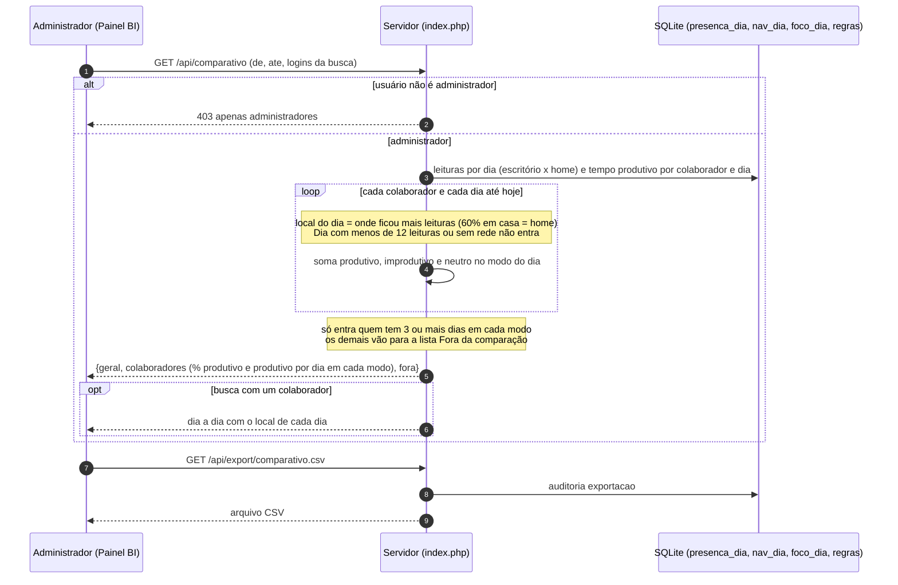

#### Relatório de produtividade (mensal, semanal ou período) e metas

Aba **Relatório** (só administradores): monta **na hora**, com os dados que a própria ferramenta coleta, o relatório que o analista fazia à mão a partir da extração semanal (700 mil linhas) e do tratamento no Excel. Não há extração, planilha intermediária nem envio manual: escolha **Mensal**, **Semanal** (segunda a domingo da semana que contém a data) ou **Período** (até 92 dias) e clique em **Imprimir / salvar PDF** (a folha já sai em A4 com as cores). Dá para gerar a qualquer momento, inclusive no meio do mês (aparece "período em andamento").

**Métricas validadas** (média geral do escritório como base inicial; as metas ficam em `relatorio_metas` no `config.php`):

| Indicador | Como é calculado | Meta |
|---|---|---|
| Tempo de tela ativo | média dos dias com uso: tempo com alguma janela em foco e sem ociosidade acima de 5 min | ≥ 6 h/dia |
| Taxa de disponibilidade | tempo ativo ÷ jornada contratual × 100 (jornada: `jornada_horas` no `config.php`, padrão 8, ou a de cada pessoa, importada do RH) | ≥ 75% |
| Tempo ocioso | por dia, o tempo entre o **primeiro e o último clique** sem atividade (inclui o almoço) | < 90 min/dia |
| Primeiro / último clique | início do primeiro e fim do último programa em foco do dia (média do período) | dentro da jornada |
| Apps e sites produtivos | participação no tempo total classificado | ≥ 70% |
| Apps e sites neutros | idem | ≤ 20% |
| Apps e sites improdutivos | idem | < 10% |
| **Score** | (produtivo × 1,0 + neutro × 0,5) ÷ tempo total × 100 (tempo total = produtivo + neutro + improdutivo) | ≥ 80 pontos |

Faixas do score: Crítico (< 30), Atenção (30-50), Regular (50-70), Bom (70-85), Excelente (85 ou mais).

**Seções:** metas do escritório, 1. sumário executivo (classificação geral, achados, evolução dos últimos 6 meses ou 6 semanas), 2. modalidade (presencial x remoto, com comparativo por cargo), 3. dia da semana, 4. distribuição por faixa, 5. alertas (crítico, atenção, 10 menores com 5+ dias, poucos dias, logins sem vínculo com o RH), 6. top 10, 7. centros de custo, 8. evolução diária, 9. recomendações (texto montado por regras a partir dos números). Cargo e centro de custo vêm do **Cadastro do RH** (Administração: digitados na tabela de colaboradores ou importados de um CSV com `login` e/ou `nome`, `cargo`, `centro de custo` e, se quiser, `jornada`). Sem o cadastro, essas seções dizem o que falta.

**Como cada dia entra:** cada colaborador conta uma vez por dia útil (um "registro"), e o dia vale pelo local onde o computador ficou mais tempo (60% das leituras em casa = dia de home). Colaboradores inativos e servidores ficam de fora. O primeiro e o último clique só existem para dias coletados a partir da versão do servidor com a tabela `atividade_dia` (os que ainda tinham dados brutos foram preenchidos na migração).

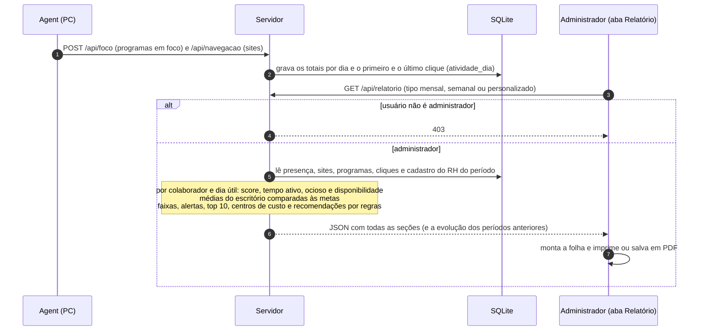

#### Relatório individual por colaborador

Em **Administração → Relatório**, o botão **Individual** (ao lado de "Escritório") abre o mesmo relatório, no mesmo modelo visual (cabeçalho, quatro indicadores, período, metas, seções numeradas e rodapé), sobre **uma pessoa**: digite parte do nome ou do login, escolha na lista e o relatório é gerado na hora para o mês, a semana ou o período escolhido. Só administradores (`GET /api/relatorio?tipo=...&login=...`); cada consulta fica na auditoria com a pessoa consultada.

| Seção | O que mostra |
|---|---|
| Cabeçalho | nome, login, cargo, centro de custo e jornada considerada |
| Metas e comparação | os mesmos 7 indicadores validados (tempo ativo, disponibilidade, ocioso, % produtivo, neutro, improdutivo e score) com o **valor da pessoa, a média do escritório e a meta** |
| 1. Sumário | classificação por faixa, achados por regras, evolução nos últimos 6 períodos |
| 2. Presencial e remoto | dias, score, tempo ativo e % produtivo em cada modo (cada dia vale pelo local onde o PC ficou mais tempo) |
| 3. Dia da semana | score e tempo por dia da semana |
| 4. Posição no escritório | posição entre quem tem 5 ou mais dias (só aparece com pelo menos 5 pessoas nessa condição) |
| 5. Onde o tempo foi gasto | tempo por tipo de uso e os 10 sites e programas mais usados, com a classificação de cada um |
| 6. Dia a dia | local, score, tempo ativo, primeiro e último clique e ocioso de cada dia |
| 7. Recomendações | texto por regras; sempre começa lembrando que o número mede **uso do computador, não resultado do trabalho** |

Com menos de 5 dias registrados o relatório avisa que o score oscila muito. Imprime em A4 ou salva em PDF pelo navegador, como o relatório geral.

#### API para o analista de dados (v1, somente leitura)

Em vez de baixar planilhas e mandar para o analista, ele (ou um script) consulta a API com um **token próprio**. É a base para gerar o relatório mensal sem trabalho manual.

**Como liberar:** Administração → **API de dados (analista)** → informe um nome, a validade (30 dias a sem validade) e, se quiser, marque **ocultar nomes e logins**. O token aparece **uma única vez**: copie e entregue ao analista. No banco fica só o hash (SHA-256). Dá para revogar a qualquer momento, e cada consulta fica na auditoria (`api_acesso`, com o nome do token).

**Segurança:** só `GET`, só HTTPS, token separado do dos agents e da sessão do painel (nenhum dos dois funciona aqui, e o token da API não funciona em outras rotas). Com **pseudonimização**, o login vira um código estável (`pXXXXXXXXXXXX`, mesmo código sempre, mas não dá para voltar ao login sem a chave `dados/pseudonimo.key`: faça backup dela junto com o banco) e o nome some. Servidores e colaboradores inativos ficam fora, como no BI.

```bash
curl -H "Authorization: Bearer ppa_..." "https://SEU-SERVIDOR/presenca/api/v1/mensal?mes=2026-10"
curl -H "Authorization: Bearer ppa_..." "https://SEU-SERVIDOR/presenca/api/v1/dias?de=2026-10-01&ate=2026-10-31&formato=csv" -o dias_outubro.csv
```

```python
import requests, pandas as pd
H = {"Authorization": "Bearer ppa_..."}
r = requests.get("https://SEU-SERVIDOR/presenca/api/v1/dias", headers=H, params={"de": "2026-10-01", "ate": "2026-10-31", "limite": 5000}).json()
df = pd.DataFrame(r["itens"])   # uma linha por colaborador e dia
```

| Rota | O que devolve |
|---|---|
| `/api/v1/saude` | Testa o token (nome, validade, se é pseudonimizado) |
| `/api/v1/colaboradores` | Cadastro: login, nome, setor, ativo, primeiro e último dia. `cargo`, `centro_custo` e `vinculo_rh` vêm `null` até a importação do RH |
| `/api/v1/dias?de&ate` | **Tabela de fatos**: uma linha por colaborador e dia (modalidade, leituras, tempo ativo, navegação, segundos produtivo, improdutivo e neutro, % produtivo, `score`, primeiro e último clique, ocioso e jornada). Máximo de 62 dias por chamada, paginada (`pagina`, `limite` até 5000), `formato=csv`, `dias=uteis` |
| `/api/v1/resumo?agrupar=` | Agregados por `dia`, `dia_semana`, `mes`, `modalidade` ou `colaborador` (padrão só dias úteis, `dias=todos` inclui fins de semana). Até 400 dias |
| `/api/v1/mensal?mes=AAAA-MM` | O mesmo relatório da aba Relatório (todas as seções, metas e recomendações) em JSON |
| `/api/v1/openapi.json` | Descrição completa (OpenAPI 3) para Postman, Power BI ou geradores de cliente |

Todos aceitam `logins=a,b` (com token pseudonimizado, use os códigos). Tempos em **segundos**. **Modalidade** de cada dia: `presencial` ou `remoto` (onde ficou mais leituras), `parcial` (poucas leituras), `sem_rede` ou `sem_leitura`. **Tempo ativo** = tempo com alguma janela em foco e sem ociosidade acima de 5 min. **% produtivo** = produtivo ÷ (produtivo + improdutivo), juntando sites e programas pela classificação do painel. O CSV da API usa vírgula e ponto decimal (o do painel é o do Excel brasileiro).

**Relatório de referência:** a aba Relatório e `/api/v1/mensal` já cobrem as seções do PDF mensal (veja a seção anterior). Cargo, centro de custo e jornada vêm do Cadastro do RH. A evolução só cobre os períodos desde que os agents começaram a enviar dados.

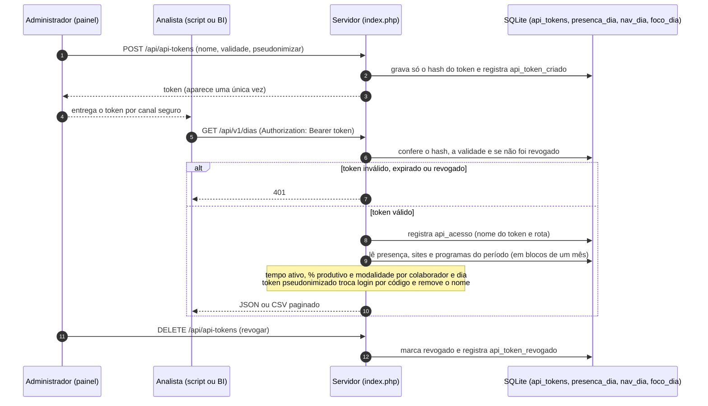

### 6.4. Limitações conhecidas

- **Navegadores:** só os que guardam o histórico em SQLite (Chrome, Edge, Brave, Firefox). Os programas desktop (Word, Legal One etc.) entram pela coleta de programas em foco (agent 1.2.0 ou mais novo), com o tempo na frente de cada janela.
- **Classificação por domínio, não por página:** `youtube.com` é tudo improdutivo, mesmo um vídeo de treinamento. Use "neutro" para domínios ambíguos. Também não há classificação por perfil (por exemplo, ferramentas de IA como produtivas para TI e fora da política para advocacia): é uma única regra para o escritório.
- **O que se mede é o uso do computador**, não o resultado do trabalho: audiências, reuniões, atendimentos e leitura em papel não aparecem. Os relatórios dizem isso e os números devem ser lidos como ponto de partida para conversa.
- **Local de quem trabalha remoto:** o painel sabe se o PC está em casa, mas não a cidade (não há geolocalização por IP). A unidade só é identificada pelas redes do escritório (`Config/unidades.json`).
- **Cargo e centro de custo** dependem do cadastro do RH (Administração → Cadastro do RH); sem ele, as análises por cargo e centro de custo ficam vazias.
- **Relatórios sob demanda:** não há envio automático (por exemplo, toda segunda-feira por e-mail); o administrador gera e imprime ou salva em PDF.
- **Teste automático da interface:** o HTML, o JS e a API são cobertos por testes (jsdom e requisições), mas não há teste de navegador de ponta a ponta; as telas são conferidas à mão a cada mudança visual.
- **Repositório:** o git não tem remoto (Azure DevOps ainda não configurado). A cópia de segurança é o `.bundle` no OneDrive, e a integração contínua é o gancho local de testes.
- **Software nos PCs:** sem certificado com chave privada (`.pfx`), sem grupos de máquinas (o alvo é por nome, com `*` e `?`), sem agendamento por horário, sem varredura de software não autorizado (conformidade só do que foi instalado por política) e sem reinício automático; a tarefa roda a cada 15 min, então a instalação não é imediata.
- **Relay do acesso remoto:** só na rede interna; fora do escritório o acesso depende de VPN.

## Licença

MIT. Veja o arquivo [LICENSE](LICENSE).
